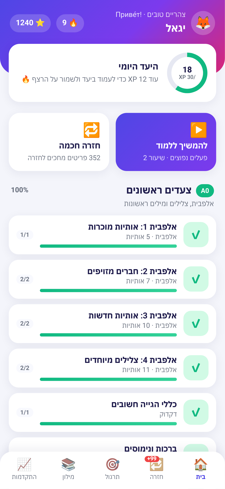
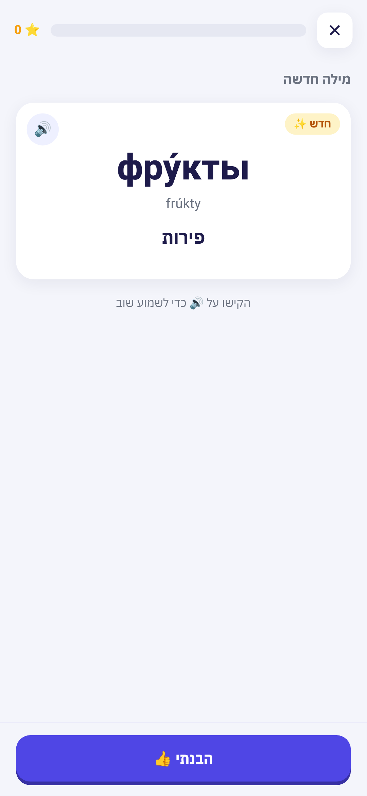
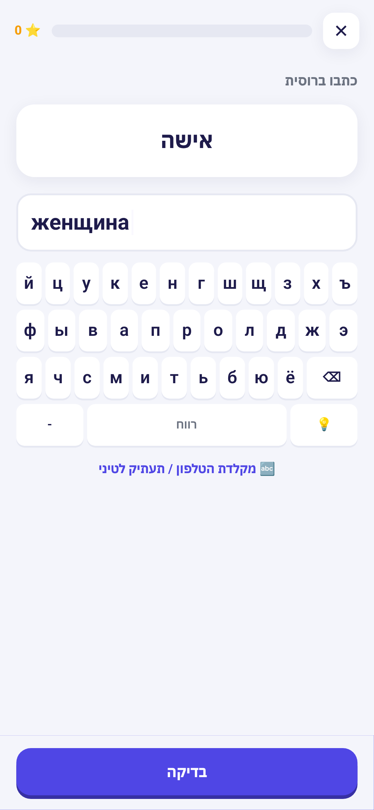
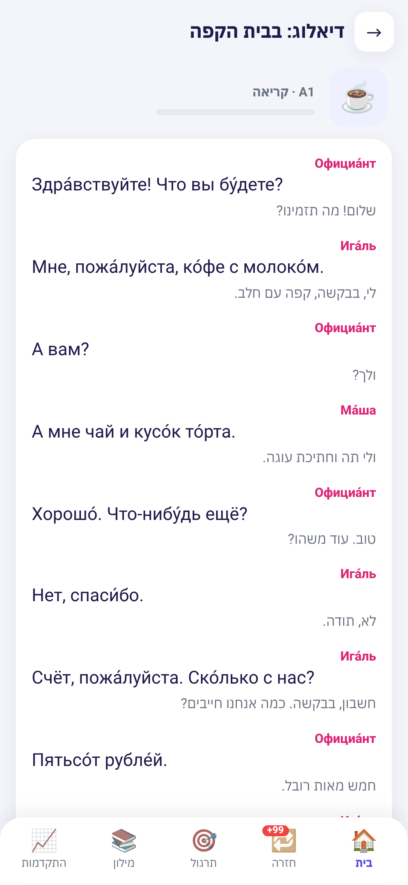

<div dir="rtl">

# רוסית בכיס

**קורס רוסית חינמי לדוברי עברית, שעובד גם בלי אינטרנט.** 70 יחידות מרמת A0 עד רוסית ליום-יום, עם אוצר מילים, דקדוק, קריאה וחזרה חכמה. בלי הרשמה ובלי פרסומות.

📱 **אפליקציית אנדרואיד:** [הורדת APK](https://igalyuze23.github.io/russian-pocket/download/russian-pocket.apk)

🌐 **לנסות בדפדפן:** https://igalyuze23.github.io/russian-pocket/app/



| מילה חדשה | הקלדה בקירילית | דיאלוג קריאה |
|---|---|---|
|  |  |  |

## ✨ יכולות

- **70 יחידות** מרמת מתחילים (A0) עד רוסית ליום-יום: אלפבית, אוצר מילים, דקדוק וקריאה.
- **1,061 מילים**, עם סימון הטעמה ותעתיק לטיני.
- **25 שיעורי דקדוק** בעברית, עם הסברים, דוגמאות ותרגול.
- **קריאה:** דיאלוגים וטקסטים ספרותיים עם שאלות הבנה.
- **חזרה חכמה (SRS)** לפי אלגוריתם SM-2, כדי לחזור על מה ששכחת בזמן הנכון.
- **תרגול:** רב-ברירה, האזנה, הקלדה בקירילית או באותיות לטיניות, התאמה, בניית משפטים וכרטיסיות.
- **מילון** ודף התקדמות, עם נקודות ניסיון ורצף יומי.
- **כמה פרופילים** על אותו מכשיר.
- **עיצוב בהיר וכהה**, בעברית, מותאם לטלפון.
- **עובד בלי אינטרנט** אחרי ההתקנה. ההגייה משתמשת בקול הרוסי שמותקן בטלפון (ובדפדפן — ב-Web Speech API).
- **פרטיות:** הכל נשמר אצלך במכשיר. אין שרת ואין מעקב.

## 📱 התקנה בטלפון (אנדרואיד)

1. מורידים את [קובץ ה-APK](https://igalyuze23.github.io/russian-pocket/download/russian-pocket.apk), שומרים אותו בטלפון, ופותחים אותו מתוך וואטסאפ (אחרי ששולחים אותו לעצמכם) או מתוך «הקבצים שלי» ← «הורדות». **לא לפתוח מתוך תצוגה מקדימה** בתוך אפליקציה.
2. בטלפוני Samsung: מכבים זמנית את **Auto Blocker** (הגדרות ← אבטחה ובטיחות ← Auto Blocker).
3. אם Google Play Protect מציע לסרוק את האפליקציה, בוחרים **«התקנה בלי סריקה»**.
4. אם תופיע בקשה לאשר התקנה ממקור לא ידוע, מאשרים.
5. אחרי ההתקנה אפשר להפעיל מחדש את Auto Blocker.

**קול רוסי:** כדי שהאפליקציה תקריא מילים ומשפטים, צריך קול רוסי במנוע ההקראה (Text-to-Speech) של הטלפון. אם הוא חסר, האפליקציה תדריך אותך איך להתקין אותו.

## ⚠️ הערות חשובות

> התוכן עדיין לא עבר ביקורת של דובר רוסית יליד. ייתכנו אי-דיוקים בהגייה, בניסוח או בדקדוק.

> 🤖 הפרויקט נבנה בעזרת בינה מלאכותית.

## 🛠️ פיתוח

קוד הממשק נמצא ב-`src/` (קבצים `app1.js`–`app5.js`), ותוכן הקורס ב-`android/assets/www/data/`. העטיפה לאנדרואיד היא אפליקציית WebView ב-`android/`.

כדי לבנות מחדש את קובץ ה-APK צריך Android SDK (build-tools 34, android.jar של API 28) ו-JDK. פרטי החתימה מגיעים רק ממשתני סביבה, ולא נשמרים בריפו:

```bash
KEYSTORE=/path/to/release.keystore KEYSTORE_PASS=... ./build.sh
```

הסקריפט כותב את `download/russian-pocket.apk` וגם מעדכן את `android/assets/www/app.js` ואת עותק הדפדפן ב-`app/`. אפשר לשנות את נתיב הפלט עם `OUT=...`. משתנים אופציונליים: `KEY_ALIAS`, `KEY_PASS`, `JAVA_HOME`, `ANDROID_SDK`, `BUILD_TOOLS`, `ANDROID_JAR`.

סקריפטי הבדיקה והצילומים נמצאים ב-`tools/` (Playwright, לשימוש בפיתוח בלבד, לא כלול באפליקציה).

## 🙏 רישיון

הפרויקט מופץ ברישיון **MIT** (ראו `LICENSE`). © 2026 Yigal Yuzefovich. אין ספריות צד-שלישי כלולות באפליקציה; הקוד הוא JavaScript ו-Java מקוריים, עם WebView ומנוע ההקראה המובנה של אנדרואיד.

</div>

---

# Russian Pocket (רוסית בכיס)

**A free Russian course for Hebrew speakers, including offline use.** It has 70 units from A0 to everyday Russian, with vocabulary, grammar, reading and spaced repetition. There is no sign-up and no ads.

📱 **Android app:** [Download the APK](https://igalyuze23.github.io/russian-pocket/download/russian-pocket.apk)

🌐 **Try it in the browser:** https://igalyuze23.github.io/russian-pocket/app/

## Features

- **70 units** from beginner (A0) to everyday Russian: alphabet, vocabulary, grammar and reading.
- **1,061 words**, with stress marks and Latin transliteration.
- **25 grammar lessons** written in Hebrew, with explanations, examples and drills.
- **Reading:** dialogues and literary texts with comprehension questions.
- **Spaced repetition (SRS)** using the SM-2 algorithm, so you review what you've forgotten at the right time.
- **Practice modes:** multiple choice, listening, typing in Cyrillic or Latin, matching, sentence building and flashcards.
- A **dictionary** and a progress page, with XP and a daily streak.
- **Multiple profiles** on the same device.
- Light and dark themes, a Hebrew UI, and a layout made for phones.
- **Works offline** after install. Pronunciation uses a Russian TTS voice installed on the phone (or the Web Speech API in the browser).
- **Private:** everything is stored on your device. There is no server and no tracking.

## Installing on Android

1. Download the [APK](https://igalyuze23.github.io/russian-pocket/download/russian-pocket.apk), save it on the phone, and open it from WhatsApp (after sending it to yourself) or from **My Files → Downloads**. **Don't open it from an in-app preview.**
2. On Samsung phones, temporarily turn off **Auto Blocker** (Settings → Security and privacy → Auto Blocker).
3. If Google Play Protect offers to scan the app, choose **Install without scanning**.
4. If you're asked to allow installs from unknown sources, allow it.
5. After the install, you can turn Auto Blocker back on.

**Russian voice:** for the app to read words and sentences aloud, the phone needs a Russian Text-to-Speech voice. If one isn't installed, the app will walk you through adding it.

## Important notes

> The content has not been reviewed by a native Russian speaker. There may be inaccuracies in pronunciation, wording or grammar.

> 🤖 This project was built with the help of AI.

## Development

The UI sources are in `src/` (`app1.js`–`app5.js`), and the course content is in `android/assets/www/data/`. The Android wrapper is a WebView app in `android/`.

To rebuild the APK you need the Android SDK (build-tools 34, API 28 `android.jar`) and a JDK. Signing credentials come only from environment variables and are not stored in the repo:

```bash
KEYSTORE=/path/to/release.keystore KEYSTORE_PASS=... ./build.sh
```

The script writes `download/russian-pocket.apk` and also refreshes `android/assets/www/app.js` and the browser copy in `app/`. Override the output path with `OUT=...`. Optional variables: `KEY_ALIAS`, `KEY_PASS`, `JAVA_HOME`, `ANDROID_SDK`, `BUILD_TOOLS`, `ANDROID_JAR`.

Test and screenshot scripts live in `tools/` (Playwright, development only, not shipped in the app).

## License

The project is released under the **MIT** license (see `LICENSE`). © 2026 Yigal Yuzefovich. No third-party libraries are bundled in the app; the code is original JavaScript and Java, using Android's WebView and the built-in TTS engine.
